

# Kietto

**Seu celular em silêncio, do jeito que você escolher.**
Filtra ligações indesejadas, protege suas horas de sono e de estudo e traz um despertador completo. Tudo roda no aparelho, sem conta e sem enviar nada para a internet.

> 🔒 **Código-fonte privado.** Este repositório é uma vitrine do projeto: o que ele faz, como foi construído
> e as decisões técnicas. Demonstração do código sob pedido.

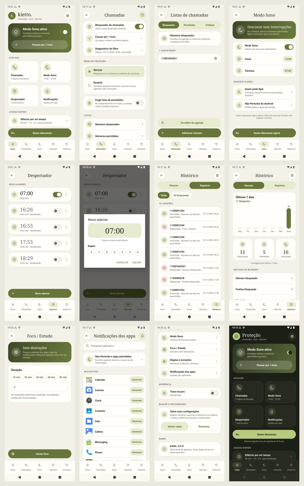

## O que o Kietto faz

| | |
|---|---|
| **Filtro de chamadas** | Bloqueia por número completo ou por prefixo (DDD e primeiros dígitos). A lista de permitidos sempre vence os bloqueios. |
| **Restringir quem pode ligar** | Só passam contatos da agenda e números permitidos. |
| **Modo Sono** | Horário diário, inclusive atravessando a meia-noite. Na hora de dormir, só toca quem você liberou. |
| **Foco / Estudo** | De 1 a 720 minutos: pausa a internet dos apps, silencia as notificações e rejeita ligações. Ao terminar, tudo volta sozinho. |
| **Bloqueio total** | Só a lista de permitidos passa, até você encerrar. |
| **Despertador** | Alarmes únicos ou por dia da semana, soneca de 5, 10 ou 15 minutos e botão de parar na tela bloqueada. |
| **Histórico e estatísticas** | Até 100 ligações analisadas, com data, hora e motivo, e o resumo dos últimos 7 dias. |
| **Backup e aparência** | Cópia manual das configurações em um arquivo e tema claro ou escuro. |

## Telas

| Início | Chamadas | Modo Sono |
|---|---|---|
| 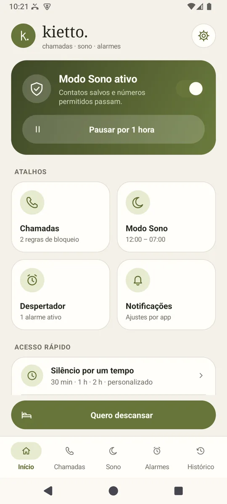 | 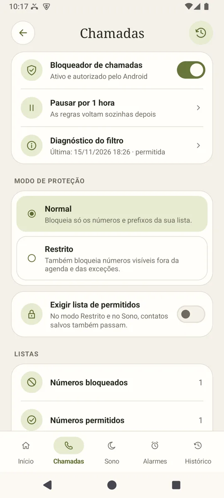 | 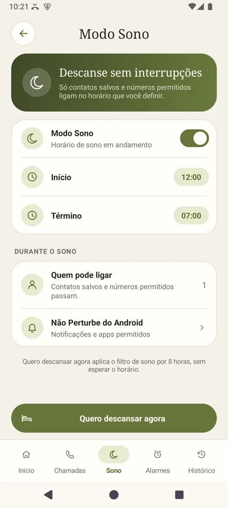 |

| Despertador | Histórico | Estatísticas |
|---|---|---|
| 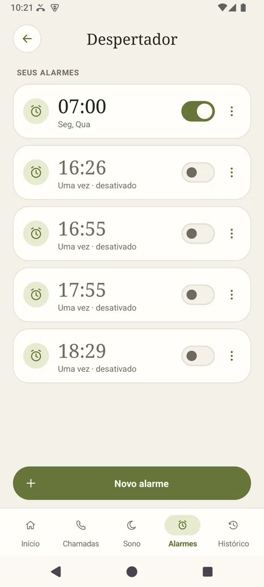 | 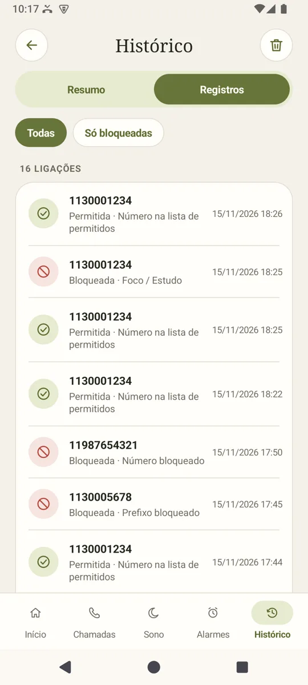 | 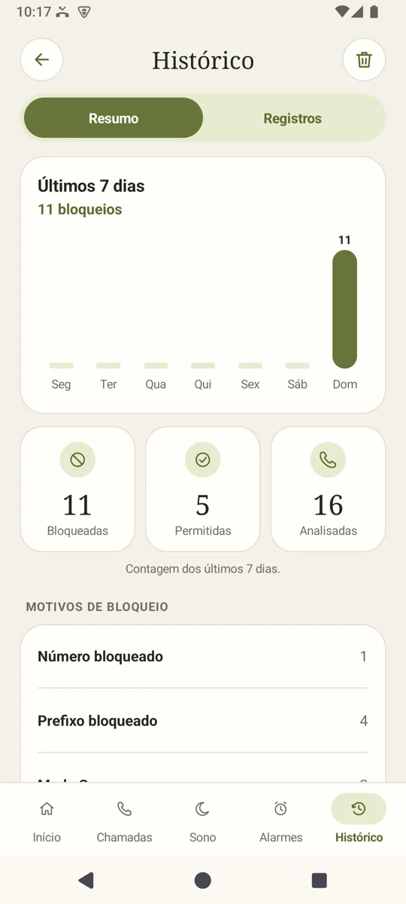 |

| Foco / Estudo | Notificações por app | Tema escuro |
|---|---|---|
| 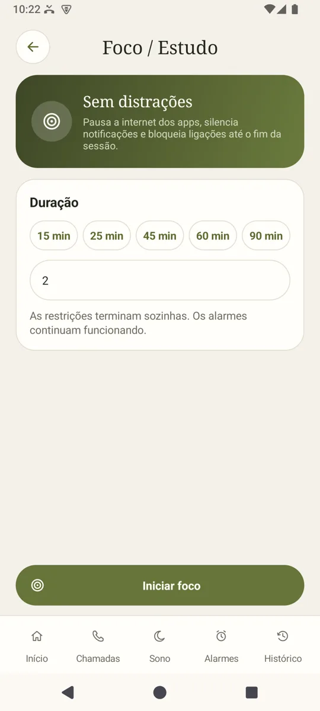 | 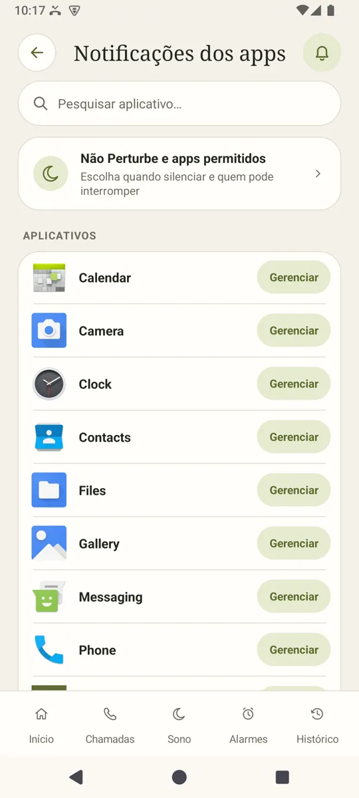 | 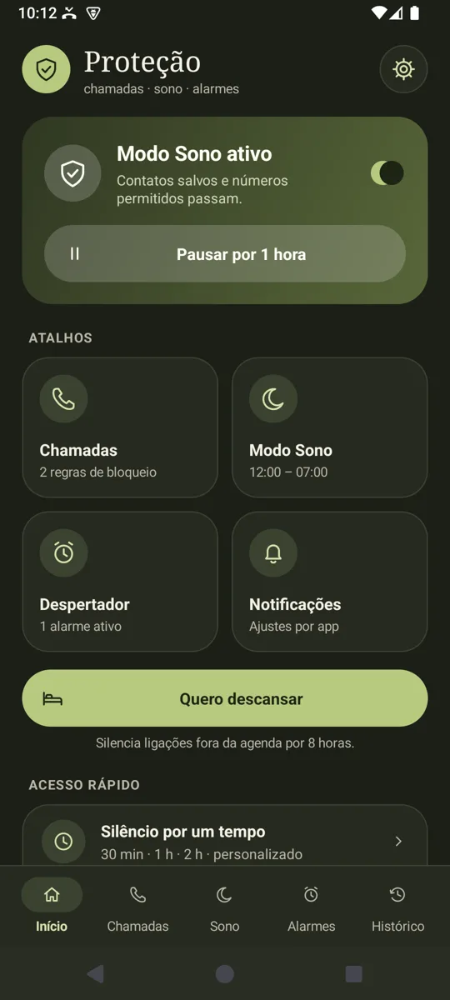 |

> Os números de telefone que aparecem são fictícios, usados nos testes.

## Como uma ligação é decidida

O Android entrega cada ligação recebida ao Kietto, que responde antes de o telefone tocar.
A ordem das regras é fixa e testada:

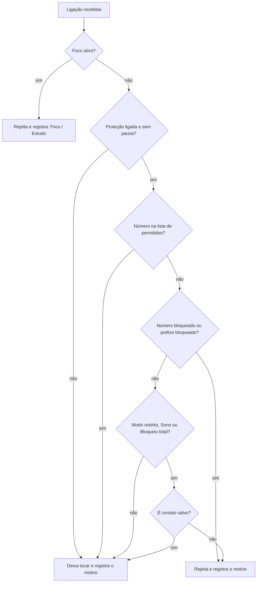

Detalhes que dão trabalho e que o app trata:
- **Normalização de números:** `+55`, `0`, operadora, parênteses e espaços viram um formato único (DDD + número), e números 0800 e similares são reconhecidos como serviço.
- **Consulta à agenda com limite de tempo:** se a agenda demorar mais de 1,5 segundo, o app decide sem ela, para nunca segurar uma ligação.
- **Sempre registra o motivo:** cada ligação analisada guarda por que foi permitida ou bloqueada (ex.: "Prefixo bloqueado", "Modo Sono").

## Decisões técnicas

- **Privacidade por padrão:** regras, contatos e histórico ficam no aparelho. Não há conta, servidor, anúncio nem rastreamento.
- **Android nativo, sem frameworks:** Java direto sobre as APIs do sistema (`CallScreeningService`, `AlarmManager`, `VpnService`, `NotificationManager` e provedor de condições do Não Perturbe). O APK tem cerca de 200 KB.
- **Foco sem servidor:** a "pausa na internet" usa uma VPN local, que só interrompe o tráfego dos apps no próprio aparelho. Nada passa por servidor externo.
- **Interface feita em código:** componentes, ícones vetoriais e paleta próprios, com tema claro e escuro.
- **Permissões só quando precisa:** contatos, alarmes exatos, tela de alarme e notificações são pedidos no momento de uso, com explicação.
- **Alarme confiável:** alarmes exatos, tela de parada na tela bloqueada e religação depois de reiniciar o celular.
- **Compilação sem Gradle:** script em PowerShell que compila, alinha e assina o APK (JDK 21 e Android SDK 36).

## Em números

| | |
|---|---|
| Código | ~5 mil linhas em 24 arquivos Java |
| APK | ~210 KB |
| Versão mínima | Android 10 |
| Dados enviados à internet | nenhum |

## Tecnologias

**Java** · **Android SDK 36** · CallScreeningService · AlarmManager · VpnService · Notificações e Não Perturbe · PowerShell (build)

## Status

Versão 0.5.0, em testes no aparelho. Em preparação para a Google Play.

---

Feito por <a href="https://github.com/lucianofonsecadev">Luciano Fonseca</a> · Brasília

